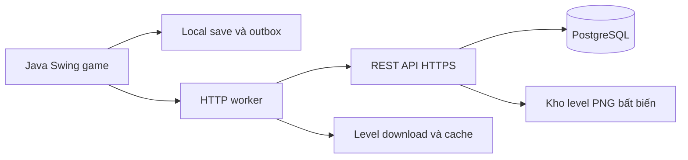

# OwletAdventure Online Backend — Phân tích và kế hoạch triển khai

> **For agentic workers:** REQUIRED SUB-SKILL: Use superpowers:executing-plans to implement this plan task-by-task. Steps use checkbox (`- [ ]`) syntax for tracking.

**Goal:** Bổ sung tài khoản, đồng bộ tiến độ, bảng xếp hạng, thành tựu, phân phối màn chơi và thống kê cho game Java desktop hiện tại.

**Architecture:** Một ứng dụng backend chia package theo tính năng, cung cấp REST API qua HTTPS, dùng một PostgreSQL. Game lưu dữ liệu cục bộ trước rồi đồng bộ bất đồng bộ; backend không tham gia vòng lặp vật lý của game.

**Tech Stack đề xuất:** Java 21, Maven Wrapper, Spring Boot, Spring Security, Spring Data JPA, Bean Validation, Flyway, PostgreSQL; client dùng Java HttpClient và Jackson. Đây là lựa chọn thiết kế, chưa phải dependency đã cài trong project. Chốt và khóa phiên bản tương thích khi bắt đầu triển khai.

**Spec:** Mục 1–9 của chính tài liệu này là đặc tả đề xuất; mục 10–13 là kế hoạch thực hiện. Trạng thái: kế hoạch, chưa triển khai backend.

## 1. Phạm vi và ưu tiên

| Nhóm | Kết quả người chơi nhận được | Ưu tiên |
|---|---|---|
| Tài khoản | Đăng ký, đăng nhập, đăng xuất; dữ liệu riêng cho mỗi tài khoản | P0 |
| Tiến độ | Thoát rồi tiếp tục từ đầu màn đã mở, đồng bộ trên máy khác | P0 |
| Kết quả và xếp hạng | Xem thành tích tốt nhất của từng màn | P1 |
| Thành tựu | Mở huy hiệu khi đạt điều kiện cụ thể | P1 |
| Quản lý màn | Tải màn mới mà không sửa code game nếu định dạng tương thích | P2 |
| Thống kê | Biết màn nào khó, tỷ lệ hoàn thành và nguyên nhân chết | P2 |

MVP phát hành đầu tiên gồm tài khoản + lưu tiến độ, có save local và chế độ khách. Bốn nhóm sau chia thành các bản phát hành độc lập. Multiplayer thời gian thực nằm ngoài phạm vi tài liệu.

Chưa bổ sung inventory, tiền tệ, cửa hàng hay boss vì code hiện tại chưa có mô hình tương ứng. Potion hiện là vật thể tiêu thụ trong màn; không đưa vào save tài khoản.

## 2. Hiện trạng và điểm tích hợp trong code

| Vị trí hiện tại | Quan sát | Việc cần làm |
|---|---|---|
| `src/main/MainClass.java`, `Game.java` | Khởi tạo toàn bộ game; loop cập nhật mục tiêu 200 UPS | Khởi tạo dịch vụ local/network; không chạy I/O trong update/render |
| `src/gamestates/Gamestate.java`, `Menu.java` | State toàn cục; menu dùng nút sprite | Thêm luồng tài khoản, Continue, đồng bộ và bảng xếp hạng |
| `src/gamestates/Playing.java:125` | `loadNextLevel()` tăng index rồi reset | Dùng level ID ổn định; áp dụng save qua một đường load level thống nhất |
| `src/gamestates/Playing.java:290` | `resetAll()` dùng khi retry, chuyển màn, về menu | Không dùng reset làm sự kiện hoàn thành; truyền lý do chuyển lượt rõ ràng |
| `src/gamestates/Playing.java:419` | Màn cuối reset index về 0 trước khi rời overlay | Chốt snapshot kết quả và campaign trước khi đổi index |
| `src/entities/EnemyManager.java` | Không còn enemy active thì hoàn thành màn | Ghi completion một lần cho mỗi lượt, gồm cả màn không có enemy |
| `src/entities/Player.java` | Có máu, power, chết, nước; chưa có đồng hồ lượt chơi | Theo dõi thời gian, damage thực nhận và nguyên nhân chết |
| `src/levels/LevelManager.java`, `Level.java` | Level theo index; ảnh mã hóa tile/entity/object bằng RGB | Thêm catalog ID/version và validation trước khi tạo entity |
| `src/utilz/LoadSave.java` | Đọc tài nguyên classpath; `/lvls` chuyển thành File | Hỗ trợ cả level bundled trong JAR và cache level tải về |
| `src/ui/*Overlay.java` | Retry/menu/next đều gọi reset từ callback chuột | Chuyển yêu cầu thay đổi gameplay vào hàng đợi game thread |
| `src/ui/AudioOptions.java`, `src/audio/AudioPlayer.java` | Có volume/mute nhưng chưa có persistence | Chỉ lưu volume, musicMuted, effectsMuted |
| `src/main/GameWindow.java`, `Game.java` | Đóng cửa sổ/QUIT kết thúc process | Save local trước khi thoát; không phụ thuộc request khi đóng |

Repo được đọc có 47 file Java và 5 ảnh `res/lvls/1.png` đến `5.png`. Chưa thấy Maven/Gradle, database, HTTP client, tài khoản hay bộ test. Graph AST chỉ dùng để tìm quan hệ; các điểm tích hợp trên đã đối chiếu source, số dòng có thể đổi khi sửa.

### Ràng buộc toàn cục

- Game phải chơi được khi backend không hoạt động; đăng nhập mới cần mạng.
- Save theo đầu màn, không khôi phục tọa độ, enemy, projectile hay animation giữa màn.
- Mỗi tài khoản có save/outbox riêng; save khách dùng namespace riêng.
- ID của tài khoản lấy từ session xác thực, không tin `userId` do client gửi.
- ID level và content version không tái sử dụng cho nội dung khác.
- Mọi request có timeout; không chặn Swing EDT hoặc game thread.
- Không ghi mật khẩu, token, request Authorization vào log hoặc analytics.
- Mỗi thay đổi schema database có migration; save local có schemaVersion.

## 3. Kiến trúc và ranh giới trách nhiệm



Backend là một process gồm package `auth`, `progress`, `runs`, `achievements`, `levels`, `analytics`. Chưa cần Redis, broker, microservices hoặc WebSocket. Giao dịch kết quả, tiến độ và thành tựu nằm cùng database để dễ đảm bảo tính nhất quán.

Gameplay tạo snapshot bất biến trên game thread. Worker nhận snapshot, ghi local rồi gửi mạng; phản hồi ảnh hưởng gameplay phải đi qua `ConcurrentLinkedQueue<Runnable>` được đọc ở đầu `Game.update()`. Các form tài khoản dùng Swing component chuẩn, cập nhật trên EDT, không tự vẽ ô password bằng sprite. Trạng thái hiển thị chỉ gồm đã lưu local, đang đồng bộ, đã đồng bộ hoặc cần đăng nhập lại.

Đề xuất Maven root quản lý hai module: `client/pom.xml` trỏ source/resource hiện có ở `../src`, `../res`; `backend/pom.xml` chứa server. Không chuyển hàng loạt file Java hiện có. Dùng Jackson cho JSON, không tự nối JSON bằng chuỗi.

## 4. Tài khoản và phiên đăng nhập

MVP dùng username + password, displayName công khai. Username chuẩn hóa lowercase, 3–32 ký tự `[a-z0-9_]`; password 12–128 ký tự, không trim; displayName 1–32 ký tự, hiển thị dạng text. Chưa có email/reset password ở bản thử nghiệm; phải bổ sung xác minh email và phục hồi trước khi mở đăng ký công khai rộng rãi.

Backend hash password qua Spring Security PasswordEncoder với bcrypt cost 12, kèm giới hạn tối đa 72 byte UTF-8 để tránh cắt ngầm. Thông báo sai tài khoản/mật khẩu giống nhau. Login giới hạn 10 lần/phút theo IP và username; register 5 lần/giờ/IP, trả 429 và Retry-After. Đây là ngưỡng ban đầu cần điều chỉnh theo số liệu vận hành.

Chọn opaque bearer session token 256 bit từ SecureRandom, thời hạn tuyệt đối 24 giờ; DB chỉ lưu SHA-256 hash token. Logout revoke session ngay. Client giữ token trong RAM; khởi động lại thì đăng nhập lại. Chưa có refresh token/remember me, tránh lưu credential vào JSON save. Nếu sau này dùng OAuth cho desktop, dùng Authorization Code + PKCE và browser hệ thống.

Khách có thể chơi trước. Sau login, UI hỏi nhập tiến độ khách vào tài khoản hay giữ riêng. Import chỉ hợp nhất màn đã hoàn thành; không gán tự động kết quả/outbox của tài khoản A cho B. Logout hủy request đang đợi theo session generation và không áp dụng response cũ lên tài khoản mới.

## 5. Lưu tiến độ và đồng bộ

### Dữ liệu và quy tắc

- `completedLevelIds`: tập ID màn đã hoàn thành, chỉ tăng trong phạm vi campaign.
- `unlockedLevelIds`: backend suy ra từ catalog thứ tự và completedLevelIds; không nhận trực tiếp từ client.
- `resumeLevelId`: màn đã mở mà người chơi muốn tiếp tục; resume từ đầu màn.
- `campaignCompleted`: backend suy ra đủ các màn bắt buộc trong campaign version; không dựa vào index hiện tại.
- `settings`: volume [0,1], musicMuted, effectsMuted. Key/độ phân giải là dữ liệu thiết bị nếu bổ sung sau.
- `revision`: số phiên bản save của tài khoản, do server tăng khi có thay đổi.

Đồng bộ dùng `PUT /me/progress` với baseRevision. Server cập nhật bằng optimistic locking; revision cũ trả 409 kèm snapshot mới. Client hợp nhất tập completed bằng union, lấy unlock từ catalog, giữ resume local nếu còn hợp lệ, rồi retry tối đa 3 lần; vẫn xung đột thì giữ pending và thử lần sync kế tiếp. Settings xung đột phải cho chọn local/cloud trong UI; không đoán bằng đồng hồ máy người chơi.

Completion claim chỉ chứng minh dữ liệu client tự báo, dùng để đồng bộ game giải trí; không dùng unlock làm bằng chứng chống gian lận.

```json
{
  "baseRevision": 7,
  "campaignVersion": "campaign-1",
  "completedLevelIds": ["level-001", "level-002"],
  "resumeLevelId": "level-003",
  "settings": {"volume": 0.7, "musicMuted": false, "effectsMuted": false}
}
```

### Save local và outbox

Lưu tại `${user.home}/.owlet-adventure/profiles/<profileId>/`, nằm ngoài source. Ghi file tạm rồi atomic move, có fallback replace và bản `.bak`; lỗi ghi phải hiển thị, không báo đã lưu. File hỏng được giữ để chẩn đoán, thử `.bak`, không tự ghi đè bằng save rỗng. Save schemaVersion không hỗ trợ thì từ chối và hướng dẫn cập nhật.

Một worker I/O tuần tự quản lý save và outbox. Mỗi snapshot tăng localRevision; ACK chỉ đánh dấu revision đã gửi, không xóa thay đổi mới tạo trong lúc request đang chạy. Ghi khi qua màn, đổi settings, về menu; thoát thì flush local có giới hạn 2 giây. Crash giữa lượt chỉ mất phần chơi từ checkpoint đầu màn.

Outbox giữ thao tác cần gửi: progress chỉ giữ snapshot mới nhất; run dùng UUID riêng; analytics batch có eventId riêng. Timeout kết nối 3 giây, mỗi request 8 giây; retry timeout/5xx/429 theo 1, 2, 4, 8, 16, 30 giây cộng jitter, tối đa 6 lần mỗi đợt. 401 yêu cầu login lại, 400/422 đưa vào trạng thái lỗi để xem, 409 theo quy tắc merge. Không retry mọi lỗi vô hạn. Chặn batch mới khi outbox kết quả chạm 10 MB và thông báo; analytics có thể bỏ dữ liệu cũ theo retention.

## 6. Kết quả lượt chơi và bảng xếp hạng

Mỗi attempt từ đầu màn có UUID `runId`, levelId/version, rulesVersion, clientVersion, elapsedMs, damageTaken, deathCause và outcome COMPLETED/DEAD/ABANDONED. `finishRun()` chỉ thực hiện một lần. Retry tạo attempt mới; số lần chết tổng của level là tổng attempt DEAD, không phải trường deaths của một attempt hoàn thành.

Thời gian dùng System.nanoTime, chỉ cộng khi gameplay thực sự chạy; dừng khi pause, mất focus, overlay hoặc rời state PLAYING. Mất focus tự pause để định nghĩa nhất quán. Damage cộng phần máu thực giảm, không phải damage yêu cầu, không giảm khi uống potion. Nước/kill đang gán trực tiếp máu phải qua hook chung để xác định deathCause và tránh thành tựu sai.

Leaderboard đầu tiên là thời gian hoàn thành tốt nhất của từng user cho từng `(levelId, levelVersion, rulesVersion)`. Chỉ lấy outcome COMPLETED. Thứ tự elapsedMs tăng, sau đó receivedAt tăng và runId để phân trang ổn định. Top 50, tối đa 100; endpoint riêng trả hạng của mình. Không trộn level đã thay đổi hoặc balance version khác nhau.

Server kiểm tra level tồn tại, version hỗ trợ, elapsedMs trong (0, 86400000], damageTaken không âm và payload <= 16 KB. Các ngưỡng khả thi theo từng màn do catalog quy định sau đo baseline; bất thường chuyển review/excluded, không coi validation là chống cheat đầy đủ. Không cấp thưởng có giá trị từ điểm client.

`(userId, runId)` unique. Gửi lại cùng nội dung trả kết quả cũ; cùng ID khác nội dung trả 409. Một transaction insert run + cập nhật personal best + thành tựu + progress union cho completed run. Save progress riêng vẫn dùng để tiếp nhận chơi offline/khách. Chưa cần replay xác minh; mọi thành tích được ghi rõ CLIENT_REPORTED.

## 7. Thành tựu

| ID | Điều kiện | Nguồn |
|---|---|---|
| first-clear | Có ít nhất một run COMPLETED | Run server nhận |
| no-damage | Run COMPLETED và damageTaken = 0 | Snapshot cuối run |
| campaign-clear | Đủ màn bắt buộc của campaign | Progress server |
| persistent-player | 10 attempt DEAD khác nhau | Run deduplicated |

Backend quyết định award dựa trên dữ liệu đã lưu; client chỉ hiển thị toast sau ACK hoặc pending offline. Unique `(userId, achievementId)` đảm bảo không mở trùng. Rules có version và lưu thời điểm cấp, run nguồn nếu có. Backfill thành tựu mới từ lịch sử trong một migration/job có thể chạy lại. Chưa tạo achievement boss vì chưa có boss. Thành tựu dùng dữ liệu client nên cùng giới hạn tin cậy với leaderboard.

## 8. Quản lý và phân phối màn chơi

Mỗi catalog entry có `levelId`, `levelVersion`, `campaignVersion`, `order`, `title`, `rulesVersion`, `minClientVersion`, `status`, `sha256`, `byteSize`, `downloadUrl`. Bản bundled 1–5 gán ID level-001 đến level-005. Published version bất biến; sửa ảnh tạo version mới và leaderboard mới. Retire không xóa lịch sử kết quả hoặc làm mất tiến độ cũ.

Giai đoạn đầu chỉ seed metadata cho màn bundled. Giai đoạn P2 thêm upload PNG giới hạn 2 MB, cao đúng 14 tile, rộng 26–512 tile, đúng một player spawn, tile/entity/object code hợp lệ. Giới hạn kích thước ảnh trước decode đầy đủ; không nhận URL tùy ý từ người upload. Tệp lưu tên do server sinh, không dùng filename làm đường dẫn. Màn trống enemy không bị cấm ngầm: cần gameplay smoke test và mục đích rõ vì hiện tại sẽ tự hoàn thành.

Luồng quản trị: upload draft → validate → chạy thử → publish trong transaction cập nhật catalog; role ADMIN, tài khoản admin tạo qua công cụ seed, không có endpoint tự nâng quyền. MVP quản trị bằng API/CLI được xác thực, chưa cần website admin.

Client chỉ tải từ HTTPS origin cho phép, stream có giới hạn byte, kiểm tra SHA-256 rồi rename vào cache. Catalog lỗi/không tương thích thì dùng bản bundled hoặc cache hợp lệ. Download không chặn startup. Khi đang chơi pin level version; bản mới chỉ có hiệu lực lần load tiếp theo. Kiểm tra cả PNG lẫn metadata trước tạo Level. Settings/event thời gian có startsAt/endsAt UTC và điều kiện active server; chưa thêm vật phẩm thưởng hoặc event currency.

## 9. Thống kê gameplay

P0 dùng bảng runs làm số liệu hoàn thành/chết, không xây event pipeline riêng. P2 bổ sung `level_started`, `level_abandoned`, `player_died`, `session_started`, `session_ended`; completion không ghi thêm event riêng để tránh đếm trùng runs.

Event chứa eventId, sessionId, runId khi có, levelId/version, type, clientTime, serverReceivedAt, payload allowlist (deathCause, tileX/tileY khi chết). Không gửi keypress từng frame, email, password, token hoặc vị trí chuột. EventId unique, giới hạn batch 50, 64 KB, giữ event thô 30 ngày rồi xóa; giữ daily aggregate 12 tháng. Cho phép tắt analytics; thao tác save vẫn hoạt động. Bản đầu chỉ nhận analytics gắn tài khoản đã đăng nhập.

Chỉ số: attempts started, tỷ lệ completed/started theo cohort ngày bắt đầu và version, số attempt chết theo cause, thời gian hoàn thành median/p95, số user chơi theo ngày UTC. Run không có kết thúc không mặc định là chết; phiên crash/mất mạng ghi unknown, loại khỏi deathCause. Event trễ cập nhật aggregate của ngày run bắt đầu, job chạy lại cửa sổ 7 ngày; dữ liệu trễ hơn dùng reprocess thủ công. Lượt chơi thiếu start vẫn được lưu nhưng không giả tạo mẫu số.

## 10. Mô hình dữ liệu và API

### Bảng PostgreSQL

| Bảng | Trường chính / constraint |
|---|---|
| users | UUID id, normalized_username UNIQUE, display_name, password_hash, role, created_at |
| sessions | id, user_id FK, token_hash UNIQUE, expires_at, revoked_at |
| player_progress | user_id PK/FK, revision bigint, campaign_version, resume_level_id, settings JSONB, updated_at |
| completed_levels | user_id, level_id, completed_at; PK(user_id, level_id) |
| level_versions | PK(level_id, version), campaign_version, order, rules_version, metadata JSONB, sha256, storage_key, status |
| runs | user_id, run_id, level_id/version FK, outcome, elapsed_ms, damage_taken, death_cause, rules_version, received_at, payload_hash; UNIQUE(user_id, run_id) |
| personal_bests | PK(user_id, level_id, level_version, rules_version), run_id FK, elapsed_ms |
| achievements | id PK, rules_version, title, definition JSONB |
| player_achievements | PK(user_id, achievement_id), source_run_id nullable, awarded_at |
| gameplay_events | event_id PK, user_id, run_id nullable, type, client_time, received_at, payload JSONB |
| daily_level_stats | PK(day, level_id, level_version), counters, duration aggregates |

Index sessions(user_id), runs(user_id, received_at), runs(level_id, level_version, rules_version, outcome), personal_bests(level_id, level_version, rules_version, elapsed_ms), gameplay_events(received_at). completed_levels tham chiếu level ID logic qua catalog; không dùng index thứ tự làm FK. Thêm bảng level_definitions khi cần FK level ID độc lập version ở migration catalog.

### API prefix `/api/v1`

| Method | Path | Quyền và hợp đồng |
|---|---|---|
| POST | /auth/register | Public; username/password/displayName; 201 hoặc 409 |
| POST | /auth/login | Public; token + expiresAt; 401 khi sai |
| POST | /auth/logout | Bearer; revoke, 204 kể cả đã revoke |
| GET | /me | Bearer; id/displayName |
| GET | /me/progress | Bearer; snapshot + revision |
| PUT | /me/progress | Bearer; baseRevision + snapshot, 409 khi cũ |
| POST | /runs | Bearer; idempotency runId; 201 mới, 200 lặp, 409 sai payload |
| GET | /leaderboards/{levelId} | Public; version/rulesVersion bắt buộc, limit/cursor |
| GET | /me/rank | Bearer; levelId/version/rulesVersion |
| GET | /me/achievements | Bearer; definitions + trạng thái đã mở |
| GET | /levels | Public; catalog tương thích clientVersion, ETag |
| GET | /levels/{id}/versions/{version}/download | Public; published only, binary PNG |
| POST | /analytics/events | Bearer; batch idempotent; 202 với accepted/duplicate/rejected IDs |
| POST | /admin/levels | ADMIN; draft upload |
| POST | /admin/levels/{id}/versions/{version}/publish | ADMIN; validate + publish |
| GET | /admin/stats/levels | ADMIN; UTC from/to, khoảng tối đa 90 ngày |

Error JSON thống nhất `{code,message,requestId,fieldErrors}`; không trả stacktrace. HTTP 400 sai JSON, 401 thiếu/hết session, 403 thiếu quyền, 404 không tồn tại, 409 conflict, 413 quá dung lượng, 422 sai dữ liệu nghiệp vụ, 429 rate limit, 503 dịch vụ chưa sẵn sàng. Auth/account response dùng Cache-Control no-store. Client không log body chứa credential.

## 11. Cấu trúc file dự kiến

```text
pom.xml, mvnw, mvnw.cmd, .mvn/                  # build reproducible
client/pom.xml                                # giữ src/ và res/ hiện tại
backend/pom.xml
backend/src/main/java/com/owlet/backend/
  BackendApplication.java
  auth/{AuthController,AuthService,SessionAuthenticationFilter,SecurityConfig}.java
  progress/{ProgressController,ProgressService}.java
  runs/{RunController,RunService,LeaderboardController}.java
  achievements/{AchievementController,AchievementService}.java
  levels/{LevelController,LevelService,LevelValidator,AdminLevelController}.java
  analytics/{AnalyticsController,AnalyticsService,StatsJob}.java
  common/ApiExceptionHandler.java
backend/src/main/resources/application.yml
backend/src/main/resources/db/migration/V1__accounts_progress_catalog.sql
backend/src/test/java/com/owlet/backend/         # theo package tính năng
src/online/{ApiClient,AuthSession,SyncService}.java
src/persistence/{LocalSaveStore,PendingOperationStore}.java
src/progress/{PlayerProgress,RunTracker,RunSnapshot}.java
src/levels/{LevelCatalog,LevelDownloadService}.java
src/ui/{AccountPanel,LeaderboardPanel,AchievementPanel}.java
compose.yaml, .env.example
docs/api/openapi.yaml, docs/operations.md
```

Các DTO/entity/repository đặt cạnh tính năng và chỉ tạo khi task cần. Không chia shared DTO module cho tới khi thực sự có lặp khó quản lý. Không đưa server model hoặc JPA entity vào game.

## 12. Kế hoạch triển khai theo giai đoạn

### Task 1 — Build và đo vòng đời lượt chơi (P0)

**Files:** root/client/backend pom và wrapper; sửa `Game`, `Playing`, `Player`, các overlay; tạo `RunTracker`, `RunSnapshot`; test `client/src/test/java/progress/RunTrackerTest.java`.

**Interfaces:** `start(levelId, levelVersion, rulesVersion)`, `tickActive(deltaNanos)`, `recordDamage(actualLoss)`, `finish(outcome, deathCause): Optional<RunSnapshot>`; finish trả empty nếu đã kết thúc. Đây là hành vi cần khóa bằng test trước khi gắn UI.

- [ ] Thêm Maven build giữ source/resource layout; chạy game từ artifact có đủ ảnh và audio.
- [ ] Viết test start → pause → resume → finish chỉ tính active time; finish hai lần chỉ có một snapshot.
- [ ] Đưa transition do overlay yêu cầu vào game command queue; phân biệt retry/next/menu/quit, không suy luận trong resetAll.
- [ ] Capture snapshot trước reset màn cuối; sửa đường load thống nhất để spawn và camera khớp level đang resume.
- [ ] Hook tất cả đường mất máu/chết, gồm direct assignment khi nước; kiểm tra damage thực giảm và no-damage không bị heal xóa lịch sử.
- [ ] Verify `mvnw.cmd -pl client test`; smoke test pause, focus lost, retry và hoàn thành màn cuối.

**Đầu ra:** lượt chơi có dữ liệu chính xác nhưng game vẫn chạy offline như trước.

### Task 2 — Save local bền vững (P0)

**Files:** `LocalSaveStore`, `PlayerProgress`, `Playing`, `GameWindow`, `Game`, `AudioOptions`; test `LocalSaveStoreTest`.

**Interfaces:** `load(profileId): PlayerProgress`, `save(profileId, snapshot): CompletableFuture<Void>`; snapshot có schemaVersion/localRevision, completed IDs, resume và settings.

- [ ] Test roundtrip, file hỏng, backup, schema mới hơn và write failure không báo thành công.
- [ ] Ghi tuần tự với temp/replace; xử lý nhiều save liên tiếp theo revision.
- [ ] Thêm Continue, kiểm tra resume tồn tại và đã mở; fallback đầu màn hợp lệ mà không xóa save gốc.
- [ ] Save qua màn/đổi settings/về menu; đóng cửa sổ và QUIT cùng đường flush local có giới hạn.
- [ ] Verify restart giữ unlock; tắt process giữa lượt chỉ mất lượt đang chơi.

### Task 3 — Backend tài khoản và catalog nền (P0)

**Files:** backend application/auth, migration V1, compose, API spec; tests `AuthIntegrationTest`, `CatalogSeedTest`.

**Interfaces:** register/login/logout/me theo mục 10; seed 5 level ID ổn định để progress tham chiếu.

- [ ] Migration users/sessions/catalog/progress; cấu hình DB bằng môi trường, không commit secret.
- [ ] Test duplicate username đã normalize, password UTF-8 quá 72 byte, sai login, expired/revoked session, role escalation.
- [ ] Thực hiện password encoding/session hash và giới hạn request; error handler không lộ stacktrace.
- [ ] Test rate limit và kiểm soát quyền bằng DB PostgreSQL thật trong môi trường test tách biệt.
- [ ] Verify `mvnw.cmd -pl backend verify`; migration chạy được trên DB rỗng và chạy lại không đổi dữ liệu.

### Task 4 — Tích hợp tài khoản và cloud save (MVP P0)

**Files:** progress server, `ApiClient`, `AuthSession`, `SyncService`, `PendingOperationStore`, `AccountPanel`, menu/input dispatch; tests `ProgressIntegrationTest`, `SyncServiceTest`.

**Interfaces:** GET/PUT progress; `sync(profileId)` chạy worker; `enqueue(snapshot)` lưu pending trước gửi.

- [ ] Test optimistic conflict giữa hai máy, union không mất completed, settings yêu cầu chọn và retry giới hạn.
- [ ] Test response revision cũ không xóa localRevision mới, timeout sau server commit rồi retry không nhân dữ liệu.
- [ ] Form login/register/logout; token chỉ RAM; logout cô lập profile và callback từ request cũ.
- [ ] Test guest import rõ ràng, đổi tài khoản A→B không gửi nhầm save/outbox.
- [ ] Thêm chỉ báo sync và login expired; chạy với fake HTTP server mô phỏng 401/409/429/500/timeout.
- [ ] Verify backend tắt 10 phút game vẫn chơi/save; bật lại đồng bộ; đăng nhập máy khác Continue đúng màn.

**Cổng phát hành MVP:** Task 1–4 qua kiểm tra, có backup/restore DB và HTTPS. Chưa cần leaderboard để phát hành bản dùng thử.

### Task 5 — Kết quả và bảng xếp hạng (P1)

**Files:** runs backend + migration V2, `LeaderboardPanel`, `SyncService`; tests `RunIntegrationTest`, `LeaderboardIntegrationTest`.

- [ ] Tạo unique run key, payload hash và personal best transaction.
- [ ] Test retry cùng run không đếm trùng; payload khác cùng ID trả conflict; rollback không để personal best mồ côi.
- [ ] Test chỉ completed được xếp hạng; best cũ không bị run chậm ghi đè; hòa điểm và cursor ổn định.
- [ ] Gửi run từ durable outbox, hiển thị pending/CLIENT_REPORTED; query tách theo version/rules.
- [ ] Verify hai tài khoản, nhiều run, offline retry và version khác nhau; dùng EXPLAIN với dataset thử để kiểm tra index.

### Task 6 — Thành tựu (P1)

**Files:** achievements + migration V3, `AchievementPanel`, completion overlay; tests `AchievementIntegrationTest`.

- [ ] Seed bốn rule tại mục 7; award trong transaction run/progress, không tạo notification mỗi lần retry.
- [ ] Test duplicate delivery, no-damage có heal, campaign từ guest import và DEAD count khác nhau.
- [ ] Backfill chạy lại không award trùng; lấy danh sách từ API khi login.
- [ ] Verify offline achievement chỉ pending đến ACK; toast không lặp khi đăng nhập lại.

### Task 7 — Catalog và tải level (P2)

**Files:** level backend, `LevelCatalog`, `LevelDownloadService`, `LoadSave`, `LevelManager`, `Level`; tests `LevelValidatorTest`, `LevelDownloadServiceTest`.

- [ ] Bổ sung draft/publish/retire và phân quyền ADMIN; storage path độc lập filename.
- [ ] Test ảnh quá lớn, mã màu không hợp lệ, spawn thiếu/trùng, hash sai, width/height sai, download bị ngắt.
- [ ] Giữ bundled resource fallback chạy trong JAR; cache chỉ thay khi download/validate hoàn tất.
- [ ] Test client cũ nhận version tương thích; retire không phá save; đang chơi không bị thay map giữa lượt.
- [ ] Verify publish một màn thử, tải ở client thứ hai; rollback catalog bằng chuyển active version đã publish.

### Task 8 — Analytics và báo cáo (P2)

**Files:** analytics backend/job, pending store, run lifecycle hooks; migration V4; tests `AnalyticsIntegrationTest`, `StatsJobTest`.

- [ ] Ghi start/abandon/death với event UUID; batch API trả kết quả từng event để chỉ retry phần thất bại.
- [ ] Test duplicate, event đến trước start, late arrival, crash thiếu end và analytics opt-out.
- [ ] Xây daily job chạy lại cho kết quả giống nhau; retention raw/aggregate theo mục 9.
- [ ] Test dữ liệu mẫu với tỷ lệ/median/p95 tính tay, quyền ADMIN và khoảng ngày giới hạn.
- [ ] Verify disabled analytics không ngăn sync tiến độ/run.

### Task 9 — Vận hành và phát hành (áp dụng từ MVP)

**Files:** `compose.yaml`, `.env.example`, `docs/operations.md`, pipeline CI khi repo được đưa vào Git.

- [ ] Health/readiness, requestId, log đã lọc secret, metrics latency/error/sync conflict và disk usage.
- [ ] HTTPS, DB chỉ mạng nội bộ, service account tối thiểu, volume bền vững cho DB và level files.
- [ ] Backup DB hằng ngày giữ 7 bản; backup level trước publish; thử restore trên môi trường riêng trước phát hành.
- [ ] Migration theo expand/contract, backend hỗ trợ client API v1; rollback application không yêu cầu drop cột ngay.
- [ ] Test tải mục tiêu thử nghiệm 50 user hoạt động, API thông thường p95 < 500 ms ở môi trường staging; đo riêng bcrypt login, không áp SLO này cho login.
- [ ] Ghi giới hạn hỗ trợ và quy trình xóa tài khoản/dữ liệu qua vận hành có xác thực trước beta công khai; xóa session, save, run và dữ liệu cá nhân liên quan.

## 13. Thứ tự, ước lượng và tiêu chí hoàn tất

```text
Task 1 → Task 2 → Task 3 → Task 4 → MVP
                         Task 4 → Task 5 → Task 6
                         Task 3 → Task 7
                         Task 1 + Task 5 → Task 8
Task 9 chuẩn bị từ Task 3, bắt buộc trước phát hành MVP
```

Ước lượng định hướng cho một developer có kinh nghiệm Java, gồm integration test và sửa lỗi, chưa gồm art/UI polish: nền game + local 4–6 ngày, account/backend 3–5 ngày, cloud sync 4–6 ngày, runs/leaderboard 3–5 ngày, achievements 2–3 ngày, level distribution 4–7 ngày, analytics 3–5 ngày, vận hành 2–4 ngày. Tổng khoảng 25–41 ngày công; người mới nên dự trù thêm thời gian học và triển khai hạ tầng. Đây không phải cam kết lịch hay chi phí hosting.

Các vấn đề cần chú ý khi review và task sở hữu:

1. Completion cuối campaign ghi đúng level trước reset — Task 1.
2. ACK cũ và đổi tài khoản không làm mất/ghi nhầm save — Task 4.
3. Retry sau timeout không đếm đôi run/thành tựu — Task 5–6.
4. Level download hỏng hoặc incompatible không khiến game mất khả năng chơi — Task 7.
5. Máy crash hoặc thiếu start event không tạo thống kê tử vong giả — Task 8.

Checklist nghiệm thu toàn bộ:

- [ ] Mở game không mạng, chơi và restart vẫn có tiến độ.
- [ ] Hai thiết bị chơi offline rồi sync không mất màn đã hoàn thành.
- [ ] Pause/focus loss/retry và màn cuối tạo dữ liệu thời gian/kết quả đúng.
- [ ] Không lấy được save người khác bằng sửa request; tài khoản thường không gọi được admin API.
- [ ] Leaderboard/version và achievements không trùng khi retry.
- [ ] Màn mới tải hợp lệ, màn lỗi có fallback; JAR bundled chạy độc lập.
- [ ] Dashboard thống kê khớp dữ liệu mẫu; analytics tắt được.
- [ ] Restore backup thành công; document đủ cách chạy, cấu hình và xử lý lỗi.

## 14. Căn cứ và giới hạn phân tích

Code tham khảo: `src/main/Game.java`, `src/gamestates/Playing.java`, `src/entities/Player.java`, `src/entities/EnemyManager.java`, `src/levels/{Level,LevelManager}.java`, `src/utilz/LoadSave.java`, các overlay và audio options. Graph được truy vấn để định vị quan hệ, không dùng suy luận graph làm chứng cứ duy nhất.

Tài liệu kỹ thuật chính thức đã tham khảo ngày 2026-11-16:

- [Spring Boot — System Requirements](https://docs.spring.io/spring-boot/system-requirements.html): đối chiếu Java/build tool khi chọn phiên bản triển khai; không mặc định project đang dùng phiên bản tài liệu này.
- [Spring Boot — Installing](https://docs.spring.io/spring-boot/installing.html): quản lý dependency qua Maven/Gradle.
- [Spring Security — Password Storage](https://docs.spring.io/spring-security/reference/features/authentication/password-storage.html): PasswordEncoder và cơ chế lưu password một chiều.
- [Spring Security — Authorization Grants](https://docs.spring.io/spring-security/reference/servlet/oauth2/client/authorization-grants.html): public client và PKCE khi mở rộng OAuth.

Tài liệu là phương án đề xuất dựa trên source, chưa có prototype backend, benchmark mạng, audit bảo mật triển khai hoặc chạy test gameplay cho các tính năng online. Số liệu năng lực phục vụ và timeline cần xác nhận bằng Task 1–4. Giới hạn lớn nhất: client desktop có thể bị sửa nên server không chứng minh được tính trung thực của kết quả tự báo.
